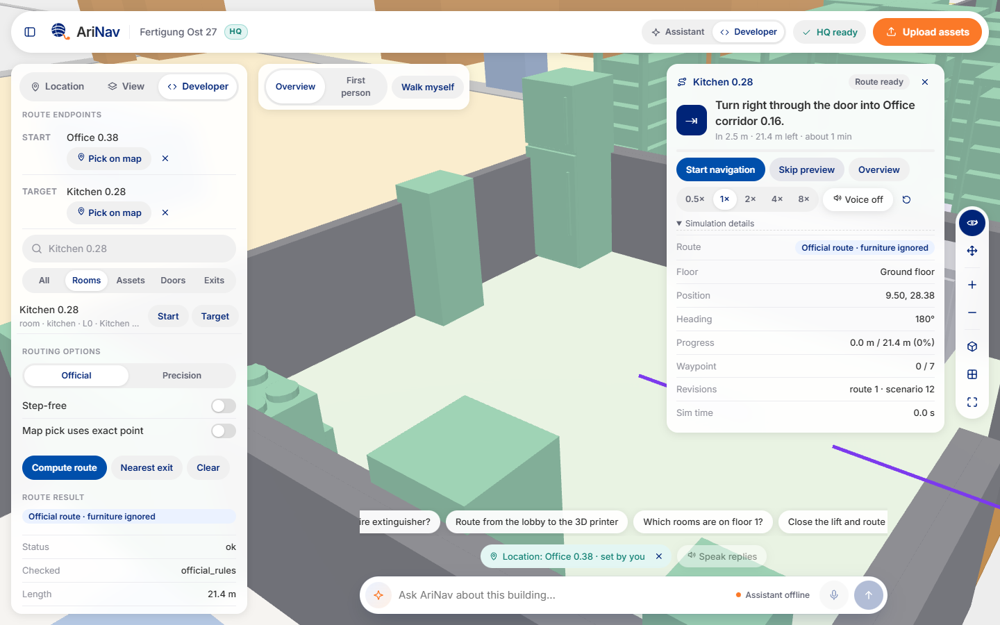
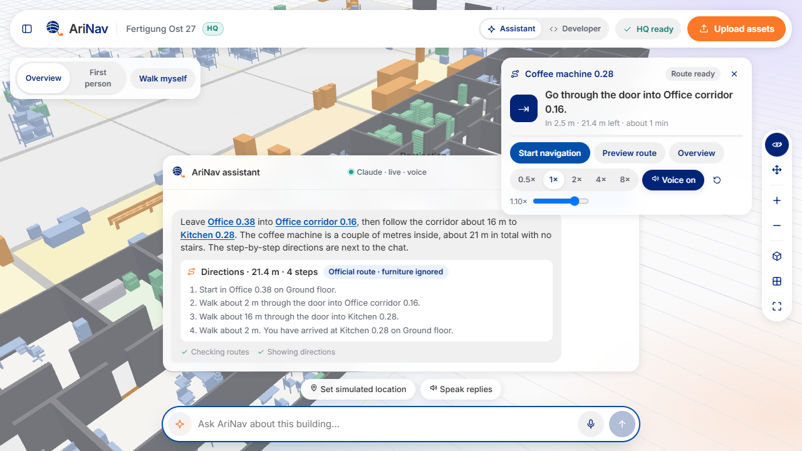
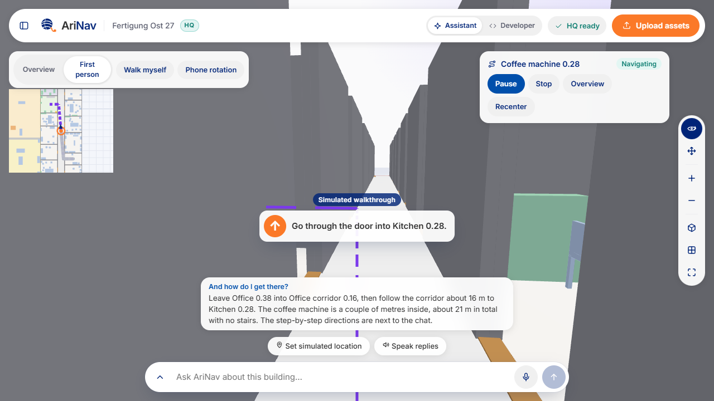
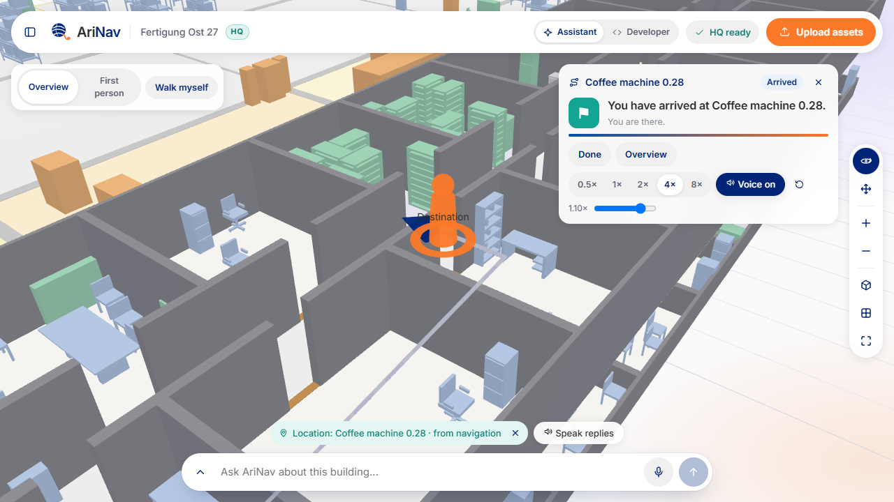
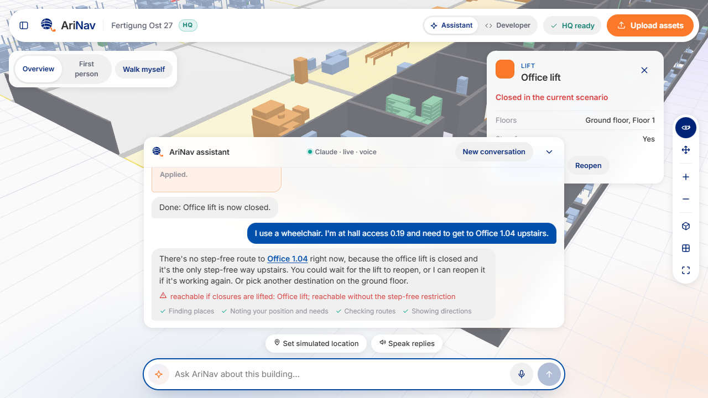
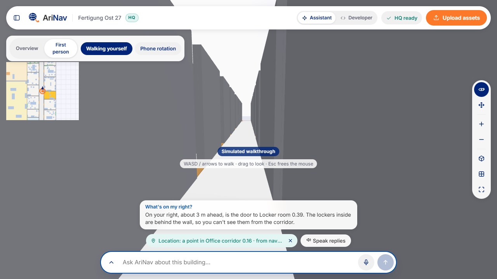
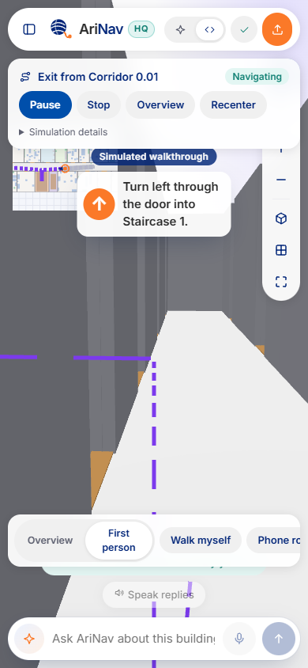
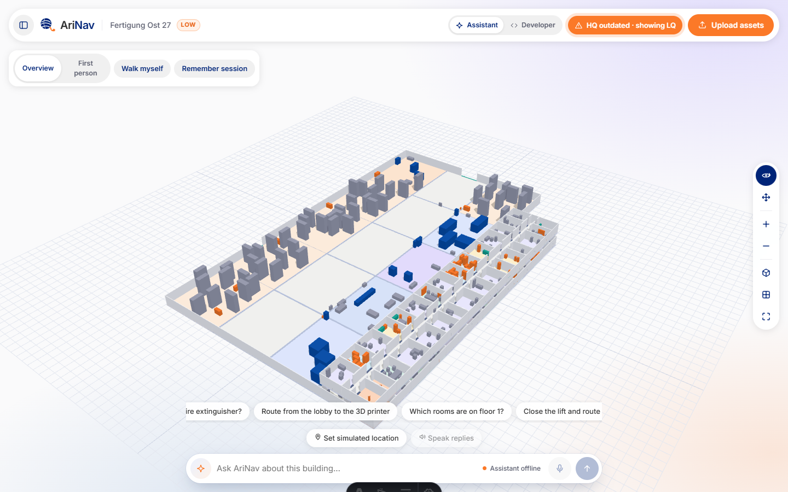
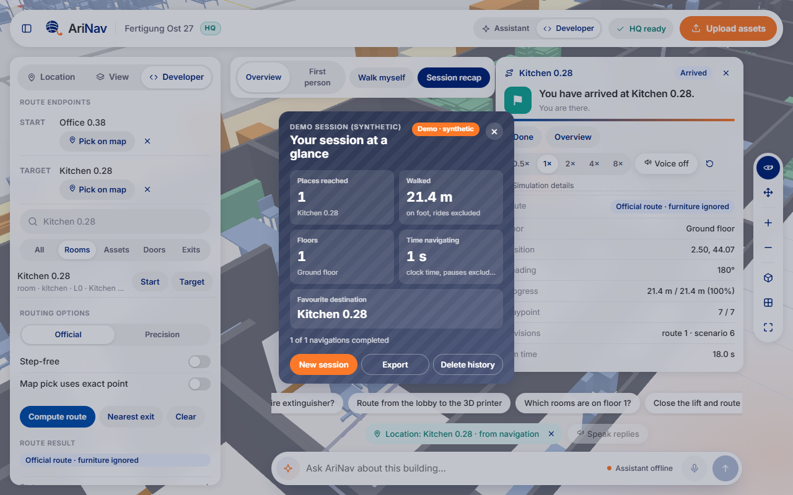

# AriNav — user guide (night build)

All screenshots are from the real app on this branch (headless Chrome, software rendering).

## Start

```powershell
# offline (no keys needed: routing, map, first person, walking, HQ models)
powershell -File scripts/windows/Start-AriNav.ps1 -DatasetsDir <SyneraKit-data\dev>
# with Claude + ElevenLabs (keys registered once with Register-ApiKey.ps1, DPAPI-protected)
powershell -File scripts/windows/Start-AriNav.ps1 -Live -DatasetsDir <SyneraKit-data\dev> [-Profile immersive]
```

Open http://localhost:4321 (`?profile=core|immersive|showcase`). Pick a building in the panel
(Location tab). Buildings with a saved high-quality model show **HQ ready**.

## 1. Ask and get a route

Say where you are and what you need ("I'm in Office 0.38. Where can I get a coffee?"), then
"How do I get there?". The official route and step-by-step directions appear; the navigation card
on the right offers **Start navigation** and **Fly-through**: a short drone video that shows the
destination, pulls out to the start, flies the route at about 3.4 m (floors above are hidden on the
way, it stops just before the target) and ends on an overview. Only the camera moves.





## 2. Walk it in first person

**Start navigation** walks a simulated person along the route (speeds 0.5×–8×, short spoken
hints when voice is available). **First person** shows the eye-height view with the next step
and a direction arrow; the minimap stays in the corner. The badge says *Simulated walkthrough*:
nothing is measured.





## 3. Accessibility is binding

Say "I use a wheelchair": every route stays step-free. If the only lift is closed, AriNav says
there is no step-free way upstairs (never a stairs fallback) and offers alternatives. Closing or
reopening anything needs your confirmation.



## 4. Walk yourself and ask what is around you

**Walk myself** is a developer tool (Developer mode): it simulates a person carrying a phone.
WASD / arrow keys, drag to look, a **Speed** slider (1–8 m/s, default 3; Shift doubles it), on
touch screens a joystick; at stairs or a lift the view offers **E / Q** (or a tap) for the floor
above/below, never stairs when step-free is on. Walls stop you; doors let you through. In the user
view, **First person** shows where you are without walking controls: there the phone itself is
the first-person screen. Ask "What's on my right?" — the answer uses your position and view
direction and never claims to see through walls.

Setting a start ("Start" in the developer panel, a map pick, "Set simulated location") always
replaces where you walked to, so the next route starts where you say you are.



## 5. On a phone

The layout keeps the view centre free in portrait and landscape; the navigation card folds to
status and controls in first person. **Phone rotation** asks for permission, then turns the view
with the phone (rotation only, never position); **Calibrate** re-aligns it. Phone browsers only
allow motion sensors on HTTPS pages: start with
`powershell -File scripts/windows/Start-AriNav.ps1 -Phone` (adds `-Live` / `-Profile` as usual),
open the printed `https://<PC IP>:4321` on the phone in the same Wi-Fi and accept the self-signed
certificate warning once. On plain http the button says *Rotation needs HTTPS*. Not yet tested on a
physical phone.



## 6. High-quality models and honesty about them

Saved HQ models load by building id and are never regenerated on open; **Rebuild** in the
processing dialog always runs. If a thing was moved after the build, the chip says
**HQ outdated · showing LQ** and the live view (which matches routing) is shown.



## 7. Session recap (showcase profile)

**Remember session** (opt-in) records only real navigation (previews do not count). **Session
recap** shows places reached, distance walked and floors; export and delete are one click.
Demo sessions are labelled synthetic.


